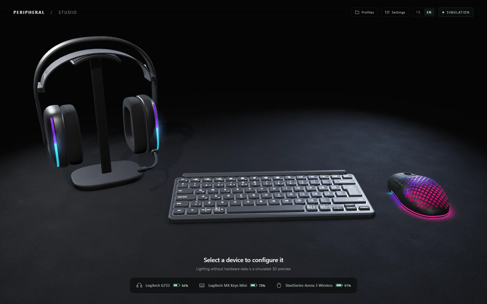
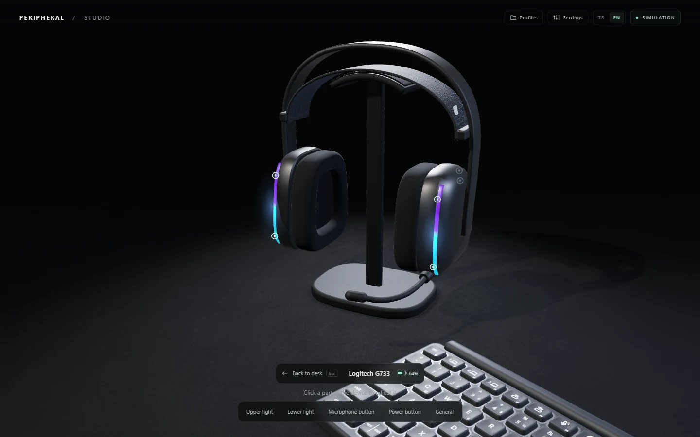
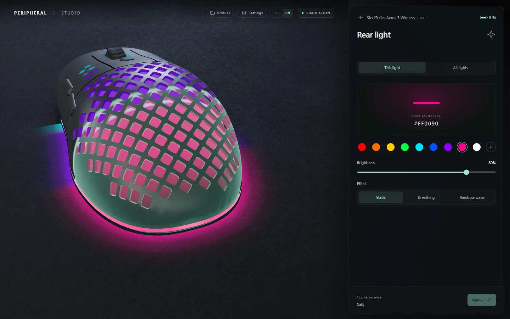
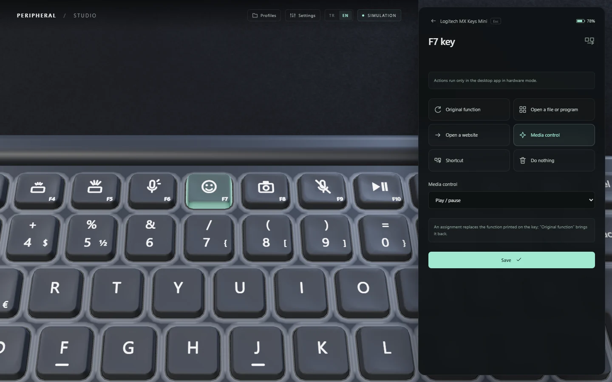
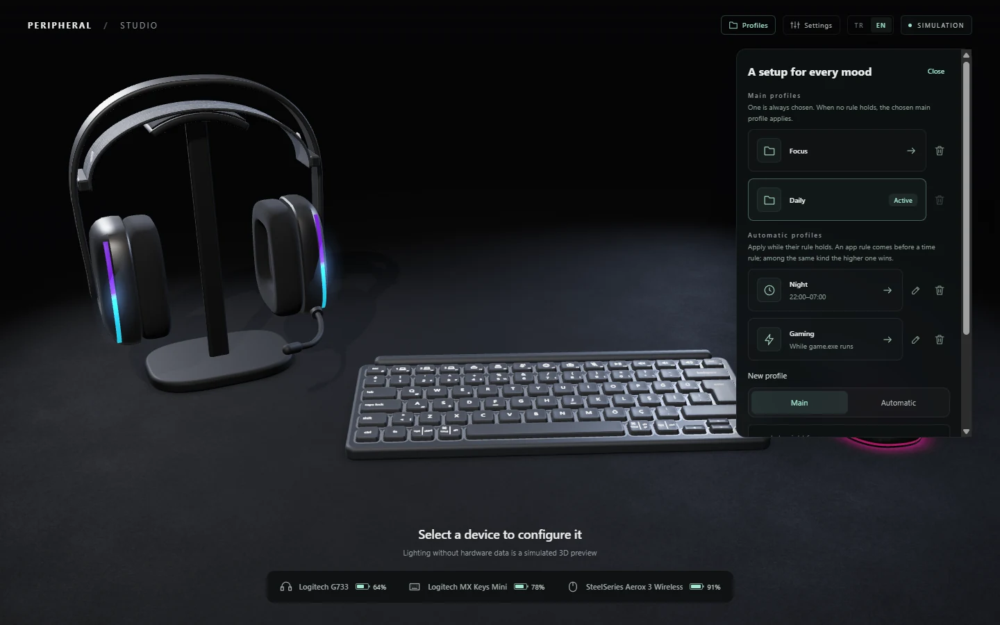
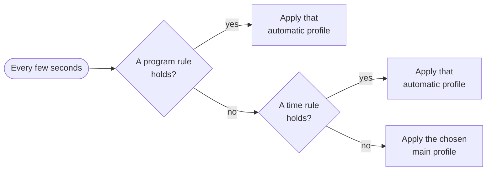
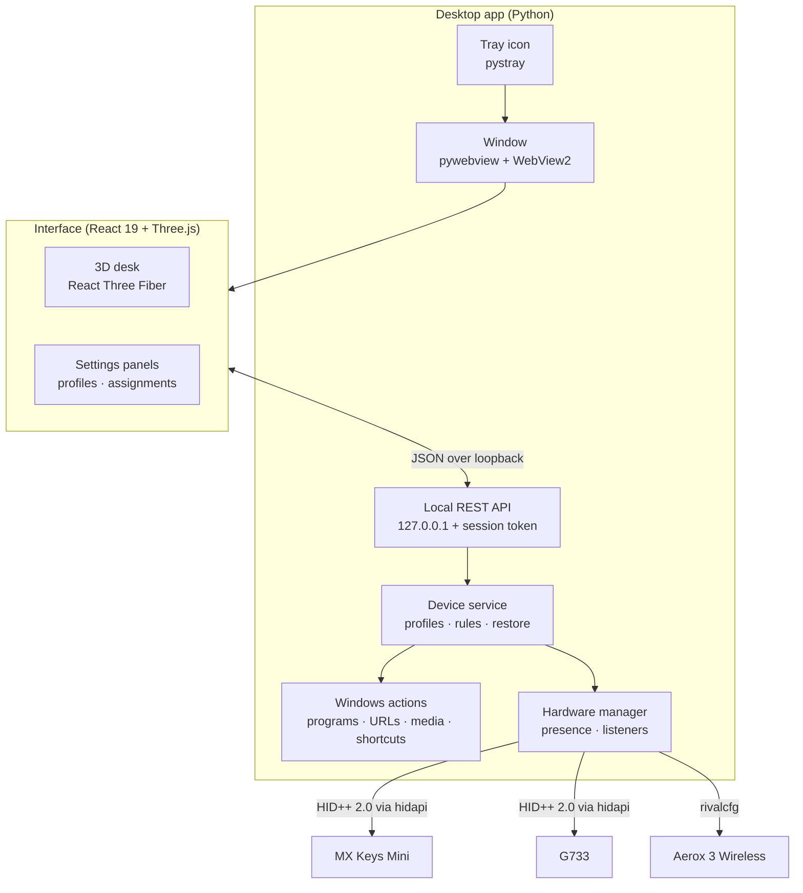

<div align="center">


# Unified Peripheral Manager

**One lightweight tray app with an interactive 3D desk for your keyboard, headset and mouse.**<br/>
Lighting, DPI, key assignments, automatic profiles and battery alerts for the Logitech MX Keys Mini,
Logitech G733 and SteelSeries Aerox 3 Wireless, without running three vendor suites.


[Features](#-features) ·
[Supported devices](#-supported-devices) ·
[Screenshots](#-screenshots) ·
[Getting started](#-getting-started) ·
[Architecture](#-architecture) ·
[Privacy](#-privacy-and-security)



<sub>Screenshots use the built-in simulation mode, so no devices are needed to try the interface.</sub>

</div>

---

## ✨ Features

| | |
|---|---|
| 🖥️ **Interactive 3D desk** | Procedurally modelled devices on a desk. Click a device and the camera flies to it; click a light zone, key or button to open its settings. The 3D lighting follows the device settings. |
| 🌈 **Lighting** | Per-zone colors (2 on the headset, 3 on the mouse), brightness, static / breathing / color-cycle effects with slow, normal or fast speed where the device supports it. Keyboard backlight off, automatic or manual (levels 0–7). |
| 🎯 **Mouse performance** | DPI from 100 to 18,000 in steps of 100 and polling rate of 125, 250, 500 or 1000 Hz. |
| ⌨️ **Key and button assignments** | MX Keys F4–F12 and Ins, the G733 microphone and power buttons, and the Aerox DPI button can open a file or program, open a website in your default browser, control media, send a shortcut, do nothing, or keep their original function. |
| 🗂️ **Main and automatic profiles** | One main profile is always chosen. Automatic profiles apply during a time range (for example 22:00–07:00) or while a program runs (for example `game.exe`), and the chosen main profile returns when no rule holds. |
| 🔋 **Battery monitoring** | Live battery levels and charging state, with a tray notification when a device drops to 20% or below. |
| ♻️ **Settings that stick** | The headset and mouse forget their settings when they power off. The app re-applies them within seconds when a device comes back, wakes up, is plugged into its cable, or the computer resumes from sleep. |
| 🪶 **Tray first, light on resources** | Starts in the notification area without a window. The 3D window opens on a click and is fully released when closed. Optional start with Windows, single instance, local logs and crash recovery. |
| 🌍 **English and Turkish** | The whole interface, tray menu and notifications follow the language you pick. |

## 🎧 Supported devices

| Device | Connection | Battery | Lighting | Performance | Assignable controls |
|---|---|---|---|---|---|
| **Logitech MX Keys Mini** | Logi Bolt receiver (HID++ 2.0) | ✅ | Backlight off / auto / manual 0–7 | – | F4–F12, Ins |
| **Logitech G733** | Lightspeed receiver (HID++ 2.0) | ✅ estimated from voltage | 2 zones · static, breathing, color cycle · speed | – | Microphone button, short press of power |
| **SteelSeries Aerox 3 Wireless** | 2.4 GHz dongle or USB cable ([rivalcfg](https://github.com/flozz/rivalcfg)) | ✅ | 3 zones · static, breathing, rainbow | DPI, polling rate | DPI button |

> [!NOTE]
> Only settings that were verified on physical devices can be written; everything else stays read-only.
> Bluetooth connections are not supported. The headset and keyboard confirm settings by reading them back;
> the mouse cannot report its settings, so the app shows the values it last sent.

## 📸 Screenshots

<table>
  <tr>
    <td width="50%"><br/><sub><b>Focus a device</b> to see its parts: light zones, buttons and general settings.</sub></td>
    <td width="50%"><br/><sub><b>Light zones</b> with colors, brightness, effect and a live 3D preview.</sub></td>
  </tr>
  <tr>
    <td width="50%"><br/><sub><b>Assign keys and buttons</b> to programs, websites, media keys or shortcuts.</sub></td>
    <td width="50%"><br/><sub><b>Profiles</b>: main profiles, and automatic ones driven by time or a running program.</sub></td>
  </tr>
</table>

## 🗂️ How profiles work



- **A program rule beats a time rule.** While a game runs at night the game profile applies; when the game closes the night profile applies again, and in the morning the main profile returns, never "the previous profile".
- **Changes go into the active profile.** Adjust a color while the night profile is active and the night profile remembers it.
- **Choosing a main profile by hand** sets the active automatic profile aside until its rule ends.
- **Devices that are off** receive the profile as soon as they come back.

## 🚀 Getting started

### Requirements

- Windows 11 with the WebView2 Runtime (included in Windows 11)
- Python 3.11 or newer
- Node.js 20.19+ or 22.12+ and [pnpm](https://pnpm.io/) to build the interface

### Run from source

```powershell
# 1. Desktop dependencies (pywebview, pystray, Pillow)
python -m pip install -e ".[desktop]"

# 2. Hardware libraries, installed beside the code (kept out of git)
python -m pip install --target hardware/vendor rivalcfg==4.17.0 hidapi==0.15.0

# 3. Build the interface
cd frontend
pnpm install
pnpm build
cd ..

# 4. Start in the tray with your devices…
python -m desktop
# …or try it without any devices
python -m desktop --simulation
```

Click the tray icon to open the window. Closing the window keeps the app running in the tray; use **Quit** in the tray menu to exit.

<details>
<summary><b>Optional: HeadsetControl fallback for the G733</b></summary>

The G733 is controlled directly over HID++. If its HID++ interface is not found, the app can fall back to
[HeadsetControl](https://github.com/Sapd/HeadsetControl) 4.2.0 for the battery reading. Place `headsetcontrol.exe`
in `hardware/tools/`. It is not part of this repository.

</details>

### Build the Windows app

```powershell
python -m pip install pyinstaller
powershell -ExecutionPolicy Bypass -File packaging/build.ps1
```

The single-file app is written to `dist/UnifiedPeripheralManager.exe`. The **Start with Windows** option is available in the packaged app.

### Run the tests

```powershell
python -m unittest discover          # backend, desktop, hardware and automation
cd frontend; pnpm test; pnpm typecheck
```

## ⚠️ Known conflicts

| Software | Effect | What to do |
|---|---|---|
| SteelSeries GG | Overrides the Aerox lighting and DPI while it runs | Close it |
| Logi Options+ | Also receives presses of keys it manages, so both actions run | Close or uninstall it |
| Windows Dynamic Lighting | Animates the G733 LEDs and overwrites its colors within milliseconds | Turn it off for the headset in *Settings › Personalization › Dynamic Lighting* |

## 🧩 Architecture



<details>
<summary><b>Project structure</b></summary>

```text
automation/   Windows input actions (shortcuts, media keys) and the action engine
backend/      Local HTTP API, device service, profiles and automatic profile rules
contracts/    API contract (JSON Schema) shared by the backend and the interface
desktop/      Launcher, window lifecycle, tray, autostart, power and logging
frontend/     React + TypeScript interface and the procedural 3D scene
hardware/     HID++ and rivalcfg device access, presence watching, device notes
packaging/    PyInstaller entry point, icon generator and build script
tests/        Cross-module API and integration tests
```

</details>

## 🔒 Privacy and security

- **Nothing leaves your computer.** There is no telemetry, account or cloud service. The interface loads no remote assets.
- **Loopback only.** The API listens on `127.0.0.1` and requires a random session token that only the app's own window receives.
- **Local data.** Settings, profiles and logs are stored in `%LOCALAPPDATA%\UnifiedPeripheralManager` and can be deleted from the app (*Profiles › Delete saved data*).
- **No elevation.** The app runs as a normal user and never asks for administrator rights.

## 🙏 Credits

- [Solaar](https://github.com/pwr-Solaar/Solaar) for its documentation of the Logitech HID++ protocol
- [rivalcfg](https://github.com/flozz/rivalcfg) (WTFPL) for SteelSeries mouse support
- [cython-hidapi](https://github.com/trezor/cython-hidapi) (BSD / GPL-3.0) for HID access
- [pywebview](https://pywebview.flowrl.com/), [pystray](https://github.com/moses-palmer/pystray) and [Pillow](https://python-pillow.org/) for the desktop shell
- [React](https://react.dev/), [Three.js](https://threejs.org/), [React Three Fiber](https://r3f.docs.pmnd.rs/) and [Vite](https://vite.dev/) for the interface

The third-party libraries are installed locally and are not part of this repository; they keep their own licenses.

## 📄 License

[MIT](LICENSE)

<sub>This project is not affiliated with or endorsed by Logitech or SteelSeries. Product names are trademarks of their respective owners. The 3D devices are generated in code and use no vendor assets.</sub>
